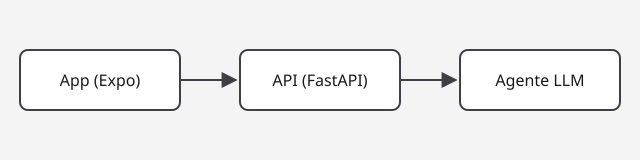

A fictitious demo project: an example of a detail page.

## The problem

Quick notes pile up with no order. The note engine classifies and links them with an LLM
agent, so nobody has to tag them by hand.

## Architecture



- **App:** Expo, one codebase for iOS, Android and the web.
- **API:** FastAPI, which stores the notes and orchestrates the agent.
- **Agent:** suggests tags and links between notes; the user accepts or dismisses them.

## Decisions

| Decision | Reason |
| --- | --- |
| Expo | One codebase for three platforms |
| FastAPI | Typed, self-documented API |
| Suggestions, not edits | The agent never changes a note without confirmation |

```ts
type Suggestion = { noteId: string; tags: string[]; links: string[] };
```

The code is in the [repository](https://github.com/ada-example/note-engine).
