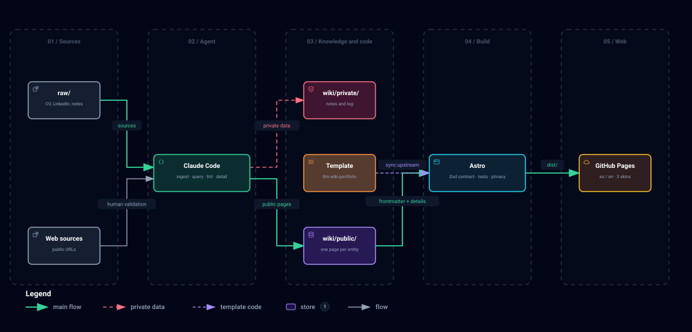

This site is not written by hand. What you read comes from a Markdown knowledge base that
an agent (Claude Code) maintains from my CV, LinkedIn and other sources.

## The problem

A portfolio, a CV and a LinkedIn profile tell the same story, but they are updated
separately. Every change has to be repeated in several places, and sooner or later they stop
matching.

## A wiki maintained by an agent

The idea comes from Andrej Karpathy's *LLM Wiki* pattern: instead of searching the sources
every time, an LLM turns them into a linked wiki and keeps it up to date. Here each piece of
the pattern has its own mechanism in Claude Code:

- Raw sources live in `raw/`, and permissions stop the agent from changing them.
- The wiki conventions are a rule that only loads when working on it.
- Each operation is a skill: `ingest` adds a source, `query` answers questions about my
  career, `lint` checks the wiki's health and `detail` drafts pages like this one.
- Nothing is written until I validate it.

## Architecture

- **Public and private wiki.** The agent keeps what can be published (`wiki/public/`, in
  git) apart from personal data and notes (`wiki/private/`, outside git).
- **Contract.** Each page's frontmatter is the interface with the site. Zod schemas validate
  it on every build: if a field is missing or a date is wrong, the build fails and names the
  file.
- **Static site.** Astro and Tailwind generate the site in Spanish and English, and GitHub
  Pages publishes it.

## Privacy by design

The repository is public, so privacy cannot depend on remembering:

- `raw/` and `wiki/private/` are in `.gitignore`.
- A test looks for phone numbers, addresses, credentials and personal paths in the public
  wiki, the generated HTML, every tracked file and the git history.
- Pages like this one, whose text is published, only allow web links and images from their
  own folder, with no HTML or links into the wiki. SVGs cannot carry scripts.

## Skins, languages and tests

The site has three skins (Terminal, Tactical and Game) and two languages. I built it with
TDD: unit, contract and component tests, E2E with axe on every skin and device, visual
snapshots, a smoke test on the real content and a JavaScript budget per page.

## A reusable template

The code lives in the [llm-wiki-portfolio](https://github.com/ARubiose/llm-wiki-portfolio)
template, with a fictitious person (Ada) as the demo. This site is one of those built from
it: it pulls improvements with `pnpm sync:upstream`, which keeps its own content.
Improvements are always made in the template.
