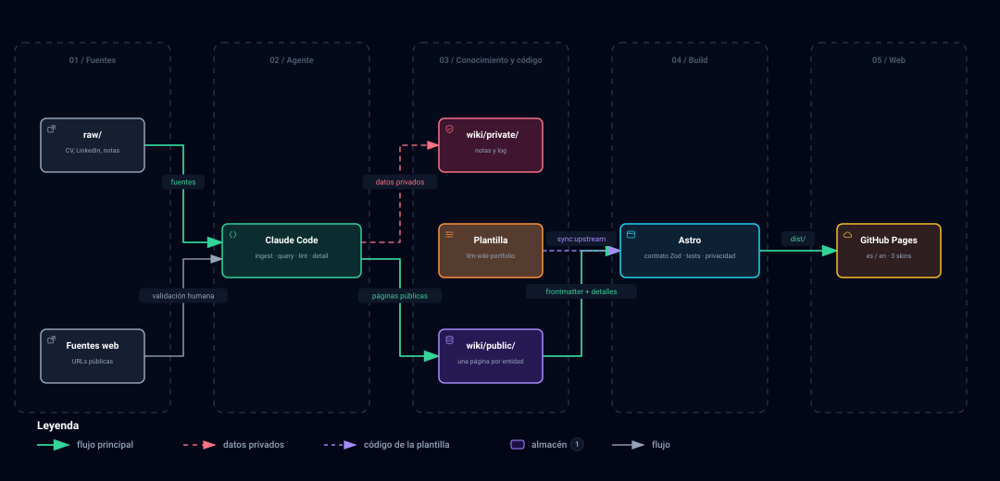

Este sitio no se escribe a mano. Lo que lees sale de una base de conocimiento en Markdown
que mantiene un agente (Claude Code) a partir de mi CV, LinkedIn y otras fuentes.

## El problema

Un portfolio, un CV y un perfil de LinkedIn cuentan lo mismo, pero se actualizan por
separado. Cada cambio hay que repetirlo en varios sitios, y antes o después dejan de
coincidir.

## Una wiki que mantiene un agente

La idea parte del patrón *LLM Wiki* de Andrej Karpathy: en lugar de buscar en las fuentes
cada vez, un LLM las convierte en una wiki enlazada y la mantiene al día. Aquí cada pieza del
patrón tiene un mecanismo propio en Claude Code:

- Las fuentes en bruto viven en `raw/`, y los permisos impiden que el agente las modifique.
- Las convenciones de la wiki son una regla que solo se carga al trabajar en ella.
- Cada operación es una skill: `ingest` incorpora una fuente, `query` responde preguntas
  sobre la trayectoria, `lint` revisa la salud de la wiki y `detail` redacta páginas como
  esta.
- Nada se escribe sin que yo lo valide antes.

## Arquitectura

- **Wiki pública y privada.** El agente separa lo publicable (`wiki/public/`, en git) de los
  datos personales y las notas (`wiki/private/`, fuera de git).
- **Contrato.** El frontmatter de cada página es la interfaz con la web. Unos esquemas Zod
  lo validan en cada build: si falta un campo o una fecha está mal, la build falla e indica
  el archivo.
- **Web estática.** Astro y Tailwind generan el sitio en español e inglés y GitHub Pages lo
  publica.

## Privacidad desde el diseño

El repositorio es público, así que la privacidad no depende de acordarse:

- `raw/` y `wiki/private/` están en `.gitignore`.
- Un test busca teléfonos, direcciones, credenciales y rutas personales en la wiki pública,
  en el HTML generado, en todos los archivos versionados y en el historial de git.
- Las páginas como esta, cuyo texto se publica, solo admiten enlaces web e imágenes de su
  carpeta, sin HTML ni enlaces a la wiki. Los SVG no pueden llevar scripts.

## Skins, idiomas y tests

El sitio tiene tres skins (Terminal, Táctico y Juego) y dos idiomas. Lo he desarrollado con
TDD, con tests unitarios, de contrato y de componentes, E2E con axe en cada skin y
dispositivo, capturas visuales, un smoke sobre el contenido real y un presupuesto de
JavaScript por página.

## Una plantilla reutilizable

El código vive en la plantilla
[llm-wiki-portfolio](https://github.com/ARubiose/llm-wiki-portfolio), con una persona
ficticia (Ada) como demo. Este sitio es uno de los que salen de ella: trae sus mejoras con
`pnpm sync:upstream`, que conserva el contenido propio. Las mejoras se hacen siempre en la
plantilla.
